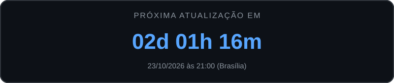
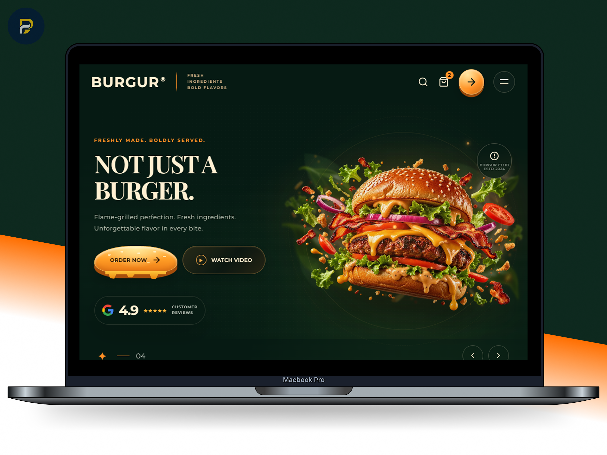
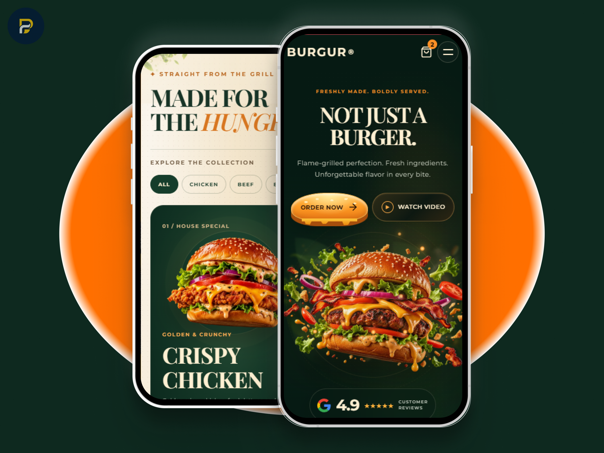
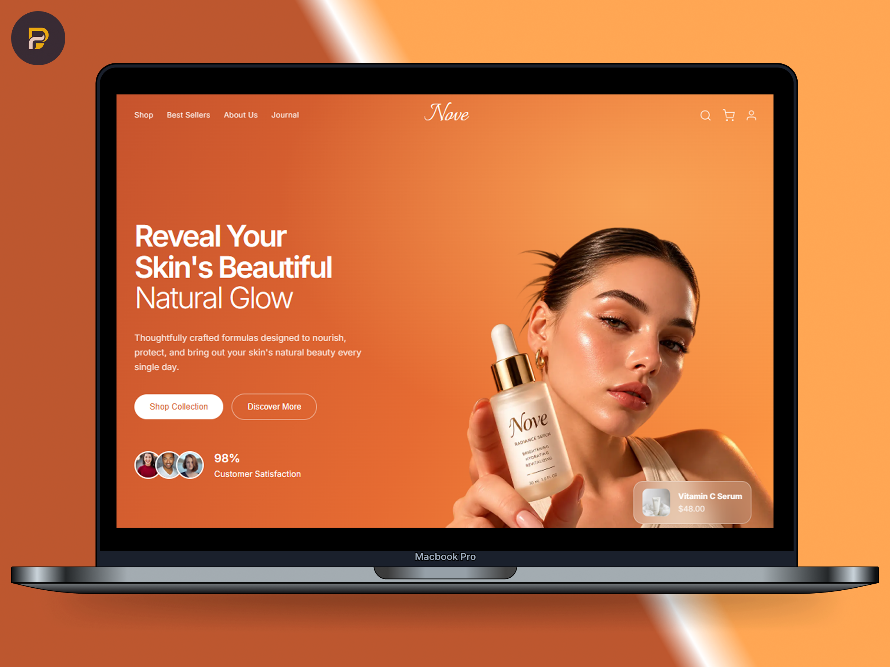
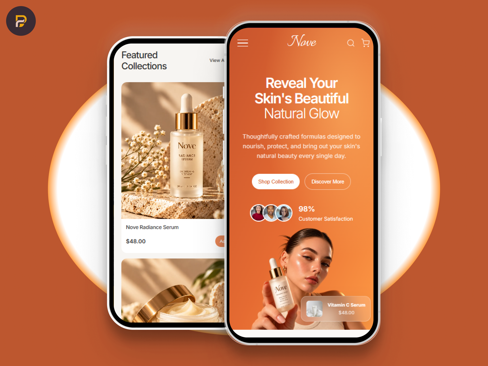

# Olá 👋, eu sou Pablo Gomes

🚀 **Desenvolvedor Front-End | React · TypeScript · JavaScript**  
🌎 Brasil | 💻 Criador da **PabloG.Dev**

Desenvolvo **sites, aplicações web e sistemas personalizados**, combinando tecnologia, criatividade e atenção aos detalhes para criar experiências digitais modernas, funcionais e responsivas.

À frente da **PabloG.Dev**, transformo ideias em soluções digitais, desenvolvendo desde **sites institucionais e landing pages até interfaces interativas e sistemas web**, com foco em **design, performance, usabilidade e experiência do usuário**.

Também desenvolvo **projetos multilíngues em português, inglês e espanhol (PT · EN · ES)**, criando experiências digitais adaptadas a diferentes públicos.

---

## 🌐 Onde me encontrar

  

  

  

  

---

## 🧠 O que eu faço

- ⚛️ Desenvolvimento de aplicações web com React e TypeScript
- 🎨 Criação de interfaces modernas, interativas e responsivas
- 💻 Desenvolvimento de sites institucionais e landing pages
- 🌎 Desenvolvimento de sites multilíngues (PT · EN · ES)
- 🧩 Desenvolvimento de sistemas web e painéis administrativos
- 🛒 Criação de interfaces para lojas virtuais e negócios digitais
- 🔗 Integração com APIs, bancos de dados e serviços externos
- ✨ Implementação de animações e experiências visuais com CSS e GSAP
- 🤖 Integração de funcionalidades com Inteligência Artificial
- ⚡ Otimização de performance, usabilidade e responsividade
- 🚀 Publicação e manutenção de projetos web

---

## 🛠️ Tecnologias

### Front-End

  

### Back-End & Banco de Dados

  

### Ferramentas

  

**Outros conhecimentos:** GSAP · REST APIs · JWT · React Router · CSS Modules · SEO · Responsividade

---

## 🚀 Projetos em Destaque

Uma seleção de projetos que demonstram minha experiência com desenvolvimento web, interfaces interativas e soluções digitais para diferentes segmentos.

### ⏳ Próxima atualização dos projetos

  

  🔄 Renovação semanal • Sexta-feira às 21h (Brasília)

---

### 🍔 BURGUR — Website de Hamburgueria

  
  

Landing page interativa para hamburgueria, com identidade visual personalizada, animações, apresentação de produtos e layout responsivo.

---

### 🧴 NOVE Skincare — Website de Beleza e Cuidados com a Pele

  
  

Landing page de skincare com identidade visual elegante, apresentação de produtos e experiência responsiva, valorizando a estética e a navegação.

---

 

👉 [**Explorar todos os projetos →**](https://pablogdev.com.br/#exemplos)

---

## 📊 Estatísticas do GitHub

  
  

---

## 🚀 Minha abordagem

> *"Acredito que desenvolver vai além de escrever código. É transformar ideias em experiências digitais que unem criatividade, tecnologia e funcionalidade."*

Busco criar projetos que se destacam não apenas pelo visual, mas também pela **qualidade, usabilidade e atenção aos detalhes**.

Por meio da **PabloG.Dev**, desenvolvo soluções digitais para diferentes segmentos, explorando novas tecnologias, aprimorando minhas habilidades e transformando ideias em projetos reais.

---

⭐ Gostou de algum projeto? Considere deixar uma estrela no repositório.

🤝 **Disponível para novos projetos, parcerias e colaborações.**

🌐 [**Conheça a PabloG.Dev →**](https://pablogdev.com.br)
